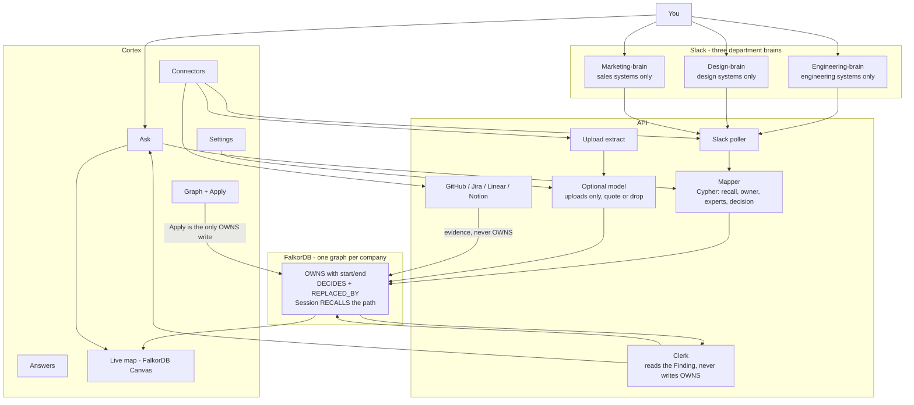
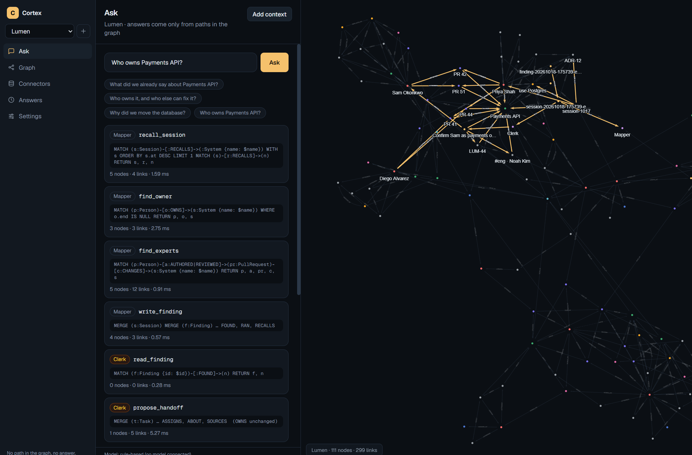
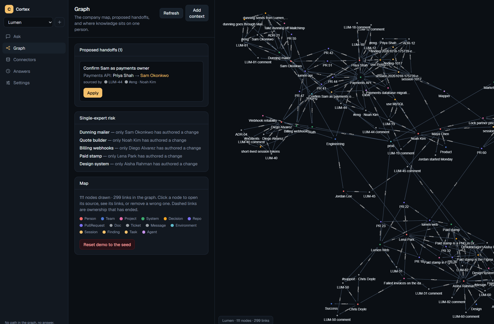
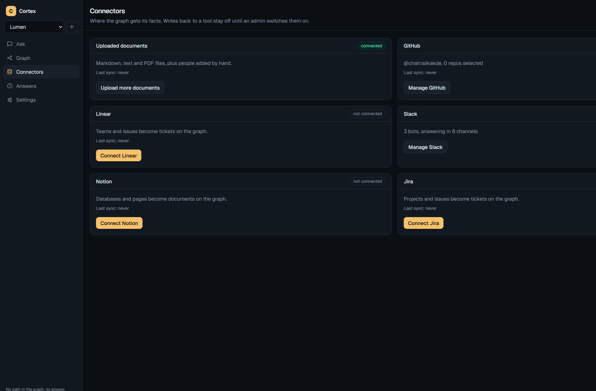
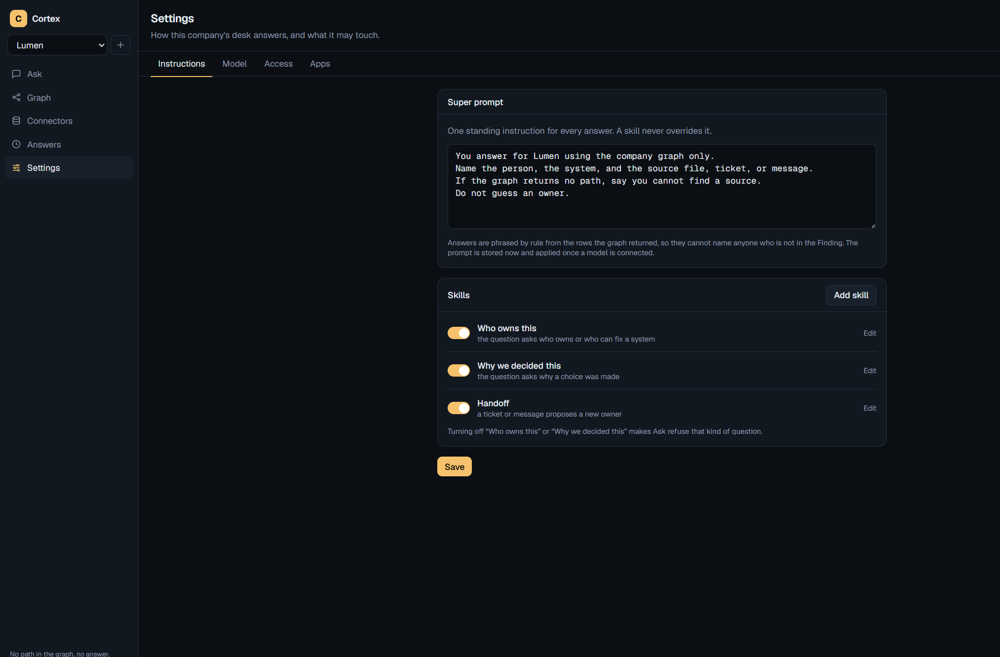
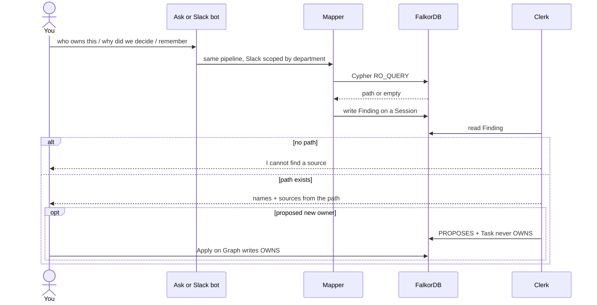

# Cortex

A company graph on **FalkorDB**. Ask who owns this, or why you decided that, in the browser or in Slack. Every answer is a path the graph returned. If there is no path, Cortex says it cannot find a source. It does not guess.



## What it is

Teams leave ownership and decisions in docs, tickets, pull requests, and chat. Cortex loads that into one graph per company. Anyone can then ask in plain language.

The reply names:

- the current owner
- other people who have actually changed that system
- the doc, ticket, or message the decision came from

It does not invent a person, a ticket, or a link.

The demo company is **Lumen**, a small startup that collects invoices for freelancers. Lumen is seeded so Ask and the map work before any live Slack or GitHub account is connected.

## How FalkorDB is used

We used FalkorDB as the core memory and source of truth for Cortex, with one graph per company. Every answer is backed by a graph path. If no supporting path exists, Cortex says it cannot find a source instead of guessing.

FalkorDB helped us solve several technical problems:

- **Reliable ownership tracking.** Ownership changes are stored as relationships with start and end dates, preserving history while identifying the current owner.
- **Shared memory for agents.** Two agents communicate through FalkorDB. One runs Cypher queries and stores its findings; the other reads those findings to generate answers, without sharing hidden state.
- **Traceable decisions.** We connect decisions to their sources and previous decisions, making it possible to trace why a choice was made.
- **Unified company knowledge.** Documents, GitHub, tickets, and Slack contribute evidence to the same graph, while ownership changes require explicit admin approval.
- **Department-level isolation.** Each Slack bot can access only the systems assigned to its department, preventing it from revealing information about other departments.
- **Session memory.** Questions and their findings are stored as graph-linked sessions, allowing Cortex to recall previous context.
- **Visual query tracing.** We display the Cypher query, execution results, and highlighted graph paths, making it easy to see how each answer was derived.

FalkorDB is not just a storage layer for Cortex. It connects the evidence, preserves the history, coordinates agent handoffs, and determines what the system can reliably answer.

Reads use `GRAPH.RO_QUERY`. Writes use `GRAPH.QUERY`. User text is always a `$param`, never pasted into Cypher.

---

## Screenshots

<p align="center">
  
</p>
<p align="center"><em>Ask — Mapper runs Cypher, Clerk reads the finding, the path hops on the canvas.</em></p>

<p align="center">
  
</p>
<p align="center"><em>Graph — a proposed handoff waits for Apply. The old OWNS link stays, with an end date.</em></p>

<p align="center">
  
</p>
<p align="center"><em>Connectors — uploads, GitHub, Slack, Jira, Linear, and Notion. They add evidence. They never write OWNS.</em></p>

<p align="center">
  
</p>
<p align="center"><em>Settings — one super prompt, skills you can turn off, and an optional model for document extraction.</em></p>

---

## What you can do

- **Ask** a question in plain language. The status line shows the agent, the Cypher, the node count, and the time. The map lights hop by hop. The sentence appears after the last hop.
- **See sources** on every answer. Click a name to open that node on the map, or follow the stored URL to the file, PR, or ticket.
- **Refuse to guess.** Unknown systems, including “it” in Slack, get “I can't find a source.”
- **Apply a handoff** on Graph. A ticket or Slack note that names a new owner becomes a task. Only Apply creates an `OWNS` link. The previous owner’s link stays, dashed, with an end date.
- **Ask the same question again** after Apply and get the new owner. Same Cypher, new path.
- **Spot a bus factor.** Graph lists systems where exactly one person has authored a change.
- **Reset the Lumen demo** back to the seed.
- **Upload** Markdown, text, or PDF. The same loader as the seed writes people, systems, and decisions. Uploads never change an owner.
- **Add a person by hand** (team, role, system, optional owner) from the context drawer or setup flow.
- **Connect GitHub.** Paste a token, pick repos, sync pull requests. Authors and reviewers become evidence. GitHub never sets an owner.
- **Connect Jira, Linear, and Notion** the same way. Tickets and pages land on the graph. None of them write `OWNS`.
- **Add Slack bots** from Connectors. Each bot is its own Slack app and `xoxb-` token. Join channels, answer in a thread, show sources, assign a department.
- **Run department brains.** Engineering, Design, and Sales bots only name their systems. Ask the wrong brain and it does not leak the hidden name.
- **Ask in Slack** with an @mention, `@botname`, a DM, or a plain who / why / what question in a listening channel.
- **Recall a stored session** (“what did we already say about …”) on the web Ask page. Slack does not reuse someone else’s last question.
- **Read Answers** — every question is a Session node linked to the path it used.
- **Set a super prompt.** One standing instruction for every answer. A skill cannot override it.
- **Turn skills on or off.** Who owns this, Why we decided this, Handoff. Off means Ask refuses that kind of question.
- **Connect a model** (OpenRouter, OpenAI, Anthropic, Gemini, Groq, Ollama, or any OpenAI-compatible URL). The key stays on the server. Today the model only reads uploads, and only keeps a fact if it quotes a sentence that is actually in the file. Answers still come from Cypher rows with or without a model.
- **Start a new company.** Name it, add people and files, then Finish. Until Finish, Ask and Slack both refuse, so a half-loaded company cannot name the wrong owner.

---

## How an answer is made

Ask does not call one model and hope. Two agents share the company graph.

1. **Mapper** runs Cypher tools and writes a Finding on a new Session: the path, the rows, who asked.
2. **Clerk** reads that Finding from FalkorDB. It does not get Mapper’s hidden notes.
3. Clerk phrases the answer from names that are in the Finding. If the path has a proposed owner, it writes a `PROPOSES` link and a Task. It never writes `OWNS`.
4. Both steps show on screen: Mapper, then Clerk, then the company nodes they used.

Mapper’s tools, in order:

| Tool | What it walks |
|---|---|
| `recall_session` | latest session about the same system (always first) |
| `find_owner` | current `OWNS` (no end date), history, pending proposals |
| `find_experts` | people who authored or reviewed a PR that `CHANGES` that system |
| `find_decision` | accepted decision, the doc it is written in, what it replaced |
| `write_finding` | stores the Finding on the Session |

Apply is not Clerk. It is the admin button on Graph.

---

## Architecture



Connectors fill the same graph. Uploads, GitHub, Jira, Linear, and Notion add evidence. They never create `OWNS`. An optional model may read an uploaded file and add a fact only if it quotes a sentence that is actually in the file. Settings holds the super prompt, skills, and the model key. The live map is FalkorDB Canvas drawing the nodes the API returned. The second question after Apply is the proof the graph did the work.

---

## Run it

```bash
docker compose up -d
```

| What | Where |
|---|---|
| Web (Compose) | http://localhost:8080 |
| Web (Next.js on the laptop) | http://localhost:3000 — keep Compose up so the API is running |
| API | http://localhost:8000 |
| FalkorDB Browser | http://localhost:3002 (optional) |
| FalkorDB | port 6379, not opened from the browser |

On API boot, if Lumen has no people, the seed is loaded. Settings, model keys, and connector tokens live on the `api_data` volume. They survive a restart. The browser never holds them.

Optional in `.env` (gitignored): `GITHUB_TOKEN`, `JIRA_SITE`, `JIRA_EMAIL`, `JIRA_API_TOKEN`, `LINEAR_API_KEY`, `NOTION_TOKEN`, `MODEL_API_KEY`. Slack bot tokens are pasted in the UI.

Judges do not need keys. The Lumen seed is enough for the web questions. Slack department brains need bot tokens if you want that live.

---

## Demo on Lumen

**Web**

1. Ask: `Who owns Payments API?` → Priya Shah since 2026-03-01, plus people who touched it. Watch the Cypher and the path.
2. Graph → Apply **Confirm Sam as payments owner**.
3. Ask the same question again → Sam. Priya’s old `OWNS` stays, dashed.

**Slack** (one bot per department)

| Channel | Ask | Expect |
|---|---|---|
| `#engineering` | `Tell me who is actually on Dunning mailer` | Sam. Nobody else has touched it. |
| `#design` | `What did we decide about Paid stamp?` | Figma SVG. It replaced the Drive PNG. |
| `#marketing` | `Remember what we already said about Quote builder?` | Maya’s stored session. Riley. Not the spreadsheet. |

Do not ask the Payments / Sam story in Slack. That one is for the web Ask + Apply loop.

---

## Stack

- **FalkorDB** — OpenCypher, one graph per company
- **FastAPI** — Mapper, Clerk, connectors, Slack polling
- **Next.js 16** + Tailwind 4 — desk UI
- **FalkorDB Canvas** — the live map

No Slack / GitHub / Jira SDK. Plain HTTPS. No MCP. No public URL required for Slack (polling).
